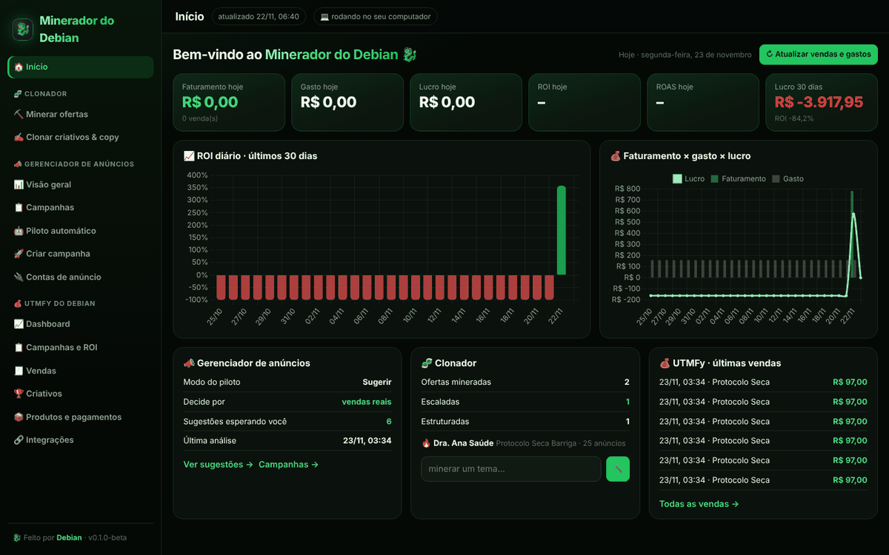
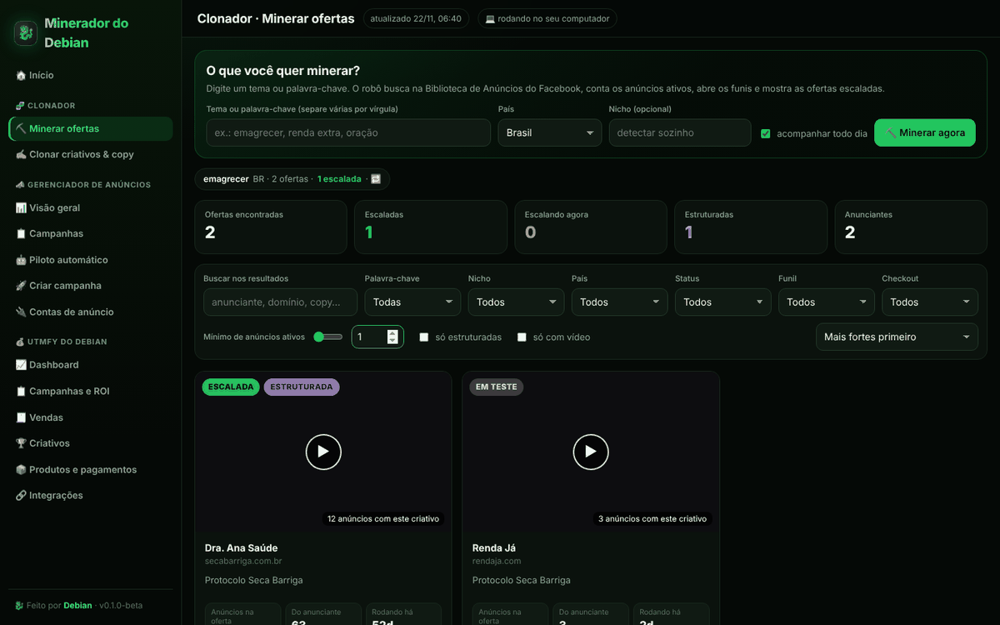
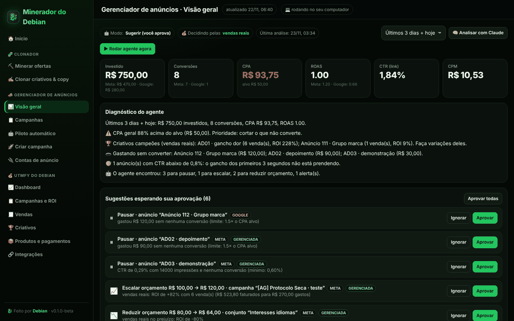
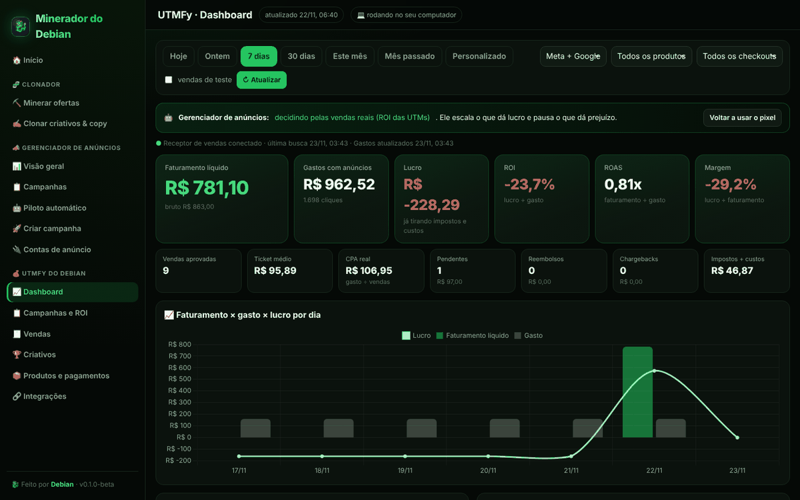

<div align="center">

# 🐉 Minerador do Debian

**Acha a oferta escalada, sobe a campanha e mostra o ROI real de cada criativo, num site só.**

[](https://github.com/AlvaroBaarros/minerador-do-debian/releases)


[](https://github.com/AlvaroBaarros/minerador-do-debian/actions/workflows/testes.yml)
[](LICENSE)



</div>

> [!NOTE]
> **Versão beta e gratuita.** Use à vontade e conte o que achou nas [Issues](https://github.com/AlvaroBaarros/minerador-do-debian/issues). Ainda estamos testando com contas reais: deixe o piloto automático no modo **Sugerir** nos primeiros dias.

Três ferramentas que todo mundo do digital usa separado, juntas num site que roda no seu computador:

| | |
|---|---|
| 🧬 **Clonador** | Você digita um tema e ele varre a Biblioteca de Anúncios. Mostra as ofertas escaladas, quantos anúncios ativos cada uma tem, o funil, o checkout, a copy e os vídeos para baixar e estudar. |
| 📣 **Gerenciador de anúncios** | Conecta na Meta e no Google, cria campanhas e tem um piloto automático que pausa o anúncio que gasta sem vender e escala o que está dando lucro, dentro dos limites que você define. |
| 💰 **UTMFy** | Puxa as vendas da Hotmart, Kiwify, Cakto e outras pelas UTMs e mostra faturamento, lucro e ROI por campanha e criativo. O piloto automático decide em cima dessa venda real. |

## 📸 Telas

| Clonador | Gerenciador de anúncios | UTMFy |
|---|---|---|
|  |  |  |

## ⬇️ Baixar e instalar

Você precisa do **Node.js 18 ou mais novo** (grátis): baixe a versão **LTS** em [nodejs.org](https://nodejs.org/pt-br/download) e instale avançando até o fim.

Depois baixe o Minerador na página de [**Releases**](https://github.com/AlvaroBaarros/minerador-do-debian/releases): o arquivo `minerador-do-debian-v….zip`. Descompacte numa pasta e siga o seu sistema:

<details open>
<summary><b>🪟 Windows</b></summary>

1. Dê dois cliques em **`iniciar-windows.bat`**.
2. Se aparecer “O Windows protegeu o computador”, clique em **Mais informações → Executar assim mesmo**.
3. Na primeira vez ele instala tudo sozinho (alguns minutos). Depois o site abre em **http://localhost:3000**.
</details>

<details open>
<summary><b>🍎 macOS (Apple Silicon e Intel)</b></summary>

1. Na pasta, clique com o **botão direito** em **`iniciar-mac.command`** → **Abrir** → **Abrir**. Só na primeira vez: o macOS pede essa confirmação para arquivos baixados da internet.
2. O Terminal abre, instala tudo sozinho (alguns minutos na primeira vez) e o site abre em **http://localhost:3000**.
3. Nas próximas vezes é só dar dois cliques no `iniciar-mac.command`.

> Se o macOS disser que o arquivo não pode ser aberto ou abrir num editor de texto: abra o **Terminal**, digite `bash ` (com espaço), arraste o arquivo `iniciar-mac.command` para a janela e aperte Enter.
</details>

<details>
<summary><b>🐧 Linux</b></summary>

```bash
cd minerador-do-debian
./iniciar-linux.sh
```
</details>

**Para fechar:** feche a janela preta (Terminal) ou aperte `Ctrl+C` nela. **Para atualizar:** baixe a versão nova e descompacte por cima da pasta antiga. Suas configurações e dados continuam lá. O menu lateral avisa quando sai versão nova.

## 🚀 Primeiros passos

A página **Início** mostra um checklist. Em resumo:

1. **Gerenciador de anúncios → Contas de anúncio:** cole o token da Meta (e, se usar, os dados do Google Ads). O passo a passo está na própria tela.
2. **UTMFy → Integrações:** ligue o receptor de vendas 24h (Cloudflare, grátis), cole os webhooks no seu checkout e as UTMs nos anúncios.
3. **Gerenciador de anúncios → Piloto automático:** defina o CPA alvo, escolha **vendas reais** e marque com 🤖 as campanhas que ele pode mexer.
4. **Clonador:** digite um tema e clique em **Minerar agora**.

Os detalhes de cada parte estão no [**Manual**](MANUAL.md).

## 💸 Custa alguma coisa?

| | |
|---|---|
| Minerador do Debian (beta) | **Grátis** |
| Análise, piloto automático, mineração | Grátis (é cálculo, não usa IA nem tokens) |
| APIs da Meta e do Google | Grátis |
| Receptor de vendas na Cloudflare | Grátis no plano gratuito |
| “Gerar copies” / “Analisar com Claude” | Grátis abrindo no seu Claude; ou centavos com chave de API (opcional) |

O único dinheiro que sai é a verba dos seus anúncios.

## 🔒 Segurança e privacidade

- Tudo roda **no seu computador**. Tokens, campanhas e vendas ficam em `trafego.local.json` e `trafego-dados/`, que **nunca** vão para o GitHub.
- O site só aceita comandos dele mesmo: outro site aberto no navegador não consegue mexer nas suas campanhas.
- **Nunca** cole tokens, chaves ou dados de clientes em Issues.

## ❓ Perguntas frequentes

<details>
<summary><b>O piloto automático roda com o computador desligado?</b></summary>

As vendas continuam chegando no receptor da Cloudflare, mas a análise e os ajustes só acontecem enquanto o Minerador estiver aberto. Uma versão 100% online está nos planos.
</details>

<details>
<summary><b>O Clonador parou de trazer ofertas</b></summary>

A Meta às vezes bloqueia acessos automatizados por um tempo. Espere algumas horas e tente de novo. Para ver o que está acontecendo, abra com `MOSTRAR=1` (Mac/Linux: `MOSTRAR=1 npm start`).
</details>

<details>
<summary><b>Posso minerar na nuvem, sem deixar o computador ligado?</b></summary>

Sim, pelo GitHub Actions (grátis): veja “Opção B” no [Manual](MANUAL.md). Para a mineração diária automática, crie a variável `MINERAR_AGENDADO=true` em *Settings → Secrets and variables → Actions → Variables* do seu fork.
</details>

## ⚖️ Aviso

O Minerador do Debian é um projeto independente e **não é afiliado** à Meta, ao Google, à Hotmart, à Kiwify, à Cakto nem a nenhuma outra plataforma citada. O Clonador lê a Biblioteca de Anúncios pública; os termos de uso da Meta não permitem coleta automatizada, então use com moderação e por sua conta. Use os vídeos e copies para **estudar e modelar** ofertas: republicar material de outras pessoas pode gerar denúncia de direitos autorais e bloqueio da sua conta de anúncios. Nenhum resultado é garantido.

## 📄 Licença

**Uso grátis, inclusive no seu próprio negócio.** O que não pode, sem autorização: vender, alugar, revender ou oferecer o Minerador como serviço. Texto completo em [LICENSE](LICENSE) (PolyForm Noncommercial 1.0.0 + permissão adicional).

<div align="center">

**🐉 Feito por Debian**

</div>
